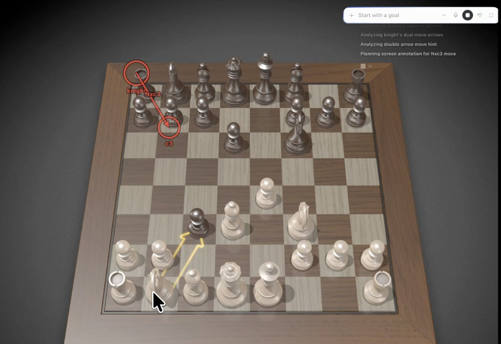

# HUD Teach

Hermes teaches you **on the real Mac window** you are using. It draws numbered,
click-through marks on the controls and shows a small step card with the
lesson: what is done, what to do now, and what comes next. That works on a
chess board, a browser game, Photoshop, a DAW, or System Settings. You keep the
mouse; the marks never block your clicks.



This is a standalone Hermes plugin, not a core patch. The overlay is a small Tk
process the plugin owns; nothing in Hermes Desktop has to change.

## What's new in 0.2.0

- **Step-by-step lessons.** The step card lists the lesson, ticks finished
  steps, highlights the current one, and the current step's badge pulses on
  screen. Hermes advances it as you go.
- **Marks stay up while you follow them.** In 0.1.x they were cleared as soon as
  Hermes finished its reply.
- **`/teach check` and `/teach demo`** tell you what is missing (permissions,
  Tk) and prove the setup works in one command.
- **More reliable placement.** Hermes reuses the capture's geometry, follows a
  window you moved, and refuses to draw on one you resized. It also says so
  when the app you named is not on screen.
- Captions on marks, a live status-bar chip in Hermes Desktop, the bundled
  skill now loads, and tests run on Linux and macOS.

Full list in [CHANGELOG.md](CHANGELOG.md).

## Install

```bash
hermes plugins install iamlukethedev/hermes-hud-teach
hermes plugins enable hud-teach
```

Start a new session so the agent sees `teach_screen`. In Hermes Desktop you can
also switch on **Capabilities → Plugins → HUD Teach** for the status-bar chip
and palette commands.

### Permissions (once)

In **System Settings → Privacy & Security**, for Hermes Desktop or the terminal
that runs `hermes`:

1. **Screen Recording**, so Hermes can see the window. Restart the app after
   granting it.
2. **Accessibility**, so Hermes can find windows by name and follow them when
   they move.

### Check and try it

```text
/teach check     # what is missing, and how to fix it
/teach demo      # 30-second sample lesson on the frontmost window
/teach demo Chess
```

The same commands work in a terminal as `hermes hud-teach check`,
`hermes hud-teach demo`, and so on. The demo outlines the window and puts a
yellow ring in the middle. Click inside the ring: the app underneath gets the
click.

## Use it

Ask in plain language while the app is visible:

- "Teach me how to export this as a PNG in Photoshop."
- "I'm playing Chess. Show me a good move for white."
- "Where do I turn on Night Shift? Show me on screen."
- "Walk me through adding a reverb send in Logic, one step at a time."

Hermes captures the window, plans the steps, and draws only the current one.
Tell it "done", or just do the step and ask "next". It captures again and moves
the card forward with finished steps ticked. Marks clear themselves after three
minutes, when the conversation ends, or on `/teach clear`.

## For agents: the `teach_screen` tool

| Action | What it does |
|---|---|
| `capture` | Screenshot a window (`target` = app or title substring, default the frontmost app). Hermes remembers its geometry for the next draw. |
| `draw` | Paint `shapes` (screenshot-pixel coordinates). Optional lesson: `title`, `steps` (`{text, done}`), `current_step`, `legend_position`. |
| `clear` | Remove the marks. |
| `list` | Visible windows with app, title and position. |
| `status` | What is on screen, the time left, and the last capture. |
| `check` | Permissions, Tk and overlay health, each with its fix. |

Shapes: `circle` (x, y, radius), `rect` (x, y, width, height), `arrow` / `line`
(fromX, fromY, toX, toY), `polyline` (points), `label` (x, y, text). Every
shape takes `step` 1–12, `color`, a short `label` caption, and `dashed`; rects
also take `fill`. Up to 24 shapes; `ttl_seconds` defaults to 180 (max 900).

```json
{
  "action": "draw",
  "title": "Export as PNG",
  "steps": [
    {"text": "Open the File menu", "done": true},
    {"text": "Choose Export → Export As…"},
    {"text": "Pick PNG, then Export"}
  ],
  "current_step": 2,
  "shapes": [
    {"kind": "rect", "x": 412, "y": 188, "width": 210, "height": 26, "step": 2, "color": "yellow", "label": "Export As…"}
  ]
}
```

The bundled skill (`hud-teach:hud-teach`) gives the agent the full lesson loop
and the pitfalls.

## What it runs on your Mac

So you know before installing:

- **Shell commands:** `osascript` (System Events, to list windows and their
  positions), `screencapture` (to screenshot the chosen window), and `sips` (to
  shrink the screenshot to at most 1280 px). Screenshots go to a temporary file
  that is deleted right away. Hermes sends the screenshot to your configured
  model, like any image you attach.
- **A background process:** a small Tk overlay (`overlay_daemon.py`) that the
  plugin starts on the first draw. It listens on a user-only Unix socket and
  exits after 30 minutes with nothing on screen, or on `/teach stop`.
- **Files:** `<HERMES_HOME>/plugin-data/hud-teach/` holds the socket, a PID file
  and the last capture's geometry (no image).
- **No network calls, no credentials, no telemetry.** Nothing clicks or types
  in your apps.

## Troubleshooting

| Symptom | Fix |
|---|---|
| Capture fails, or the image is only the wallpaper | Grant Screen Recording to the app running Hermes and restart it. Run `/teach check`. |
| "No visible window matches …" | The app is not on screen or has another name. The error lists what is visible. |
| "was resized since the capture" | Ask Hermes to capture again; the old coordinates no longer match. |
| "Overlay daemon did not start" | Hermes's Python lacks Tk. The python.org, Homebrew `python-tk`, and `uv` builds include it. |
| Clicks hit the marks | Run `/teach clear` and draw again. |
| Marks stay after you are done | `/teach clear`, the Desktop palette **Clear screen marks**, or wait for the TTL. |

## Requirements

- macOS (Hermes still loads the plugin elsewhere; `/teach check` explains)
- Hermes `>= 0.20`
- Python with Tk

## Development

```bash
PYTHONPATH=. python -m unittest discover -s tests -v
```

The overlay test starts the real Tk daemon and needs a display. On Linux, run
it under Xvfb:

```bash
PYTHONPATH=. xvfb-run -a python -m unittest discover -s tests -v
```

Run the catalog's admission check locally:

```bash
hermes plugins validate . --install-deps
hermes plugins doctor . --ci
```

Smoke the overlay without the agent:

```bash
python -c 'from overlay import draw; print(draw(bounds={"x":80,"y":80,"width":640,"height":400}, frame_width=1280, frame_height=800, shapes=[{"kind":"circle","x":400,"y":300,"radius":40,"step":1,"color":"yellow","label":"here"}], title="Smoke test", steps=[{"n":1,"text":"Look for the ring","done":False}], current_step=1, ttl_seconds=10))'
```

## License

MIT. See [LICENSE](LICENSE).
